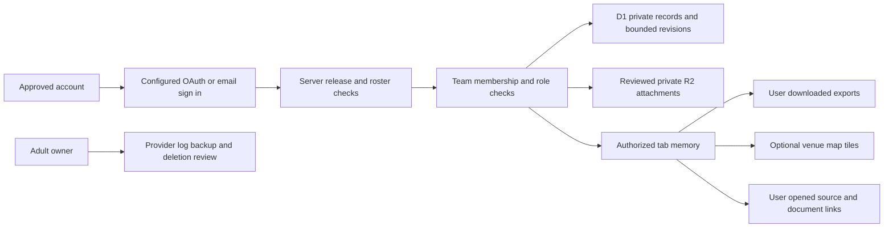

# MyFTCSpace release evidence and operating plan

Prepared November 2, 2026 for the supplied MyFTCSpace Official Review Readiness Checklist. Initial rollout, as clarified by the project lead: Delaware, United States, for multiple teams in schools and other organizations, with mentor/coach oversight and team leads assisting with routine support. Future United States expansion is intended, subject to review of each additional state and organization before onboarding. This packet records implemented controls and work still requiring evidence. It does not sign, initial, or approve the official checklist.

**Release decision remains pending.** No named accountable adult/organization, monitored contact address, signed school/legal/vendor decisions, or actual production access configuration has been supplied. All 43 reviewer decisions in `config/readiness.example.json` remain PENDING. A software role or a completed JSON record cannot authenticate a signature, verify consent, establish legal applicability, or replace an organization's approval.

## Vercel target change (November 2, 2026)

The deployment target changed from the Sites/Cloudflare Worker runtime to Vercel Next.js. The current source adds Auth.js Google/Microsoft/Apple OAuth and email links and Vercel server functions. It keeps the existing Cloudflare D1 and private R2 stores, accessed through Cloudflare's D1 HTTP API and R2's S3 API using server-only environment secrets. The hosting, identity and storage vendor flow has materially changed; all 43 decisions must be reviewed again against the exact deployment and current provider contracts. See [Vercel deployment guide](vercel-deployment.md).

OAuth account IDs are provider-scoped and differ from Sites-provided ChatGPT account IDs. Existing team membership IDs and readiness allowlists will not automatically transfer. If the current database contains real or retained team records, an organization-approved identity/data migration is required before those users regain access. If not, launch with newly reviewed accounts and clean teams. The prior approval fingerprint is invalidated by this source change. GitHub origin is now `qkzp/delaware-ftc-hq`, with a successful Vercel status reported for the existing main commit on November 2, 2026. The listed production website is `https://delaware-ftc-hq.vercel.app`. There is no local Vercel project link or configured OAuth/Cloudflare credential in this workspace; production provider settings, migration and hosted acceptance remain unverified.

## Responsibilities and review scope

The current source adds multiple adult operators through the existing reviewed mentor/admin roles; adult-admin invitations now permit another operator to join, subject to the same production adult roster. No member can self-certify adulthood. Team chat is scoped to current team membership. Private DMs require adult-admin enablement, are participant-only in the app, support blocking and explicit safety reports, and are not end-to-end encrypted. Operators cannot silently browse unrelated DMs; an explicit report copies only the selected message into the adult privacy/safety queue. Message text is limited to 2000 characters and sending is rate-bounded. Sender removal clears message content; reported/exported copies follow separate procedures. Chat retention is 1–30 days (30 default), pruned on activity and by a secret-protected daily job that the hosting operator must verify.

Apple sign-in and 15-minute single-use email links are supported when configured. iCloud Mail is an email address option, distinct from Apple ID. The D1 authentication adapter retains necessary email lookup and minimal provider-link records, excludes profile names/images and OAuth access tokens, and atomically consumes hashed verification tokens. Resend is a new transactional authentication-mail provider requiring review. There is no sponsor-outreach sender. New schema migration `0002_messaging_and_email.sql`, provider credentials and cron setup must be applied and verified before these features are activated. See [provider setup](provider-setup.md).

Motor/servo tracking extends the shared parts register, with server-validated specifications and the existing lead/mentor/admin editing permissions. Students can read shared specs. Device records identify models, purposes, configuration names/ports, status, output-shaft RPM, voltage, encoder conversion, external gearing and wheel size; servo specs distinguish positional and continuous rotation, with travel/speed/torque where applicable. Applying an installed motor copies its specifications into the planner and uses RPM for wheel-speed and encoder-segment timing estimates. A local wheel calculator accepts up to ten mixed gear, chain/sprocket, toothed-belt/pulley or pitch-diameter belt stages, plus known ratios, and multiplies their driven/driver ratios. It reports wheel RPM and rolling speed in imperial/metric units, supports inch/mm wheel dimensions, imports tracked motor specs, exports calculations and transfers supported results into the planner. Idle guiding parts do not add reduction; direction, slip, load and mecanum effects are not simulated. These estimates are not live robot telemetry or learned physical calibration. The public tracker is tab-only and offers an export; authorized team records persist in D1.

Interface reliability update: semantic light/dark tokens, relative font units, compact in-flow feedback and at least 44px native button targets replace fixed light colors and cramped controls. A visual-viewport handler scrolls focused inputs above a resized keyboard viewport; physical iOS/Android testing remains pending. Stable local display/view preferences survive deployments and cache upgrades. Public static asset caching excludes pages, APIs, sessions and private files; storage failures fall back to normal networking. Rapid repeat clicks/submits are suppressed, identical in-flight API writes are coalesced within the account boundary, and raw technical errors are replaced with actionable copy. Named loading/error/first-use states keep navigation meaningful. These controls do not promise offline team-data access, durable cross-device idempotency, physical keyboard conformance or absence of every possible defect.

Engineering additions: robot/season profiles save dimensions, drivetrain, waypoints and entered obstacles. Motor histories link numerical tests to a profile/device, retain at most 200 representative observations and preserve peaks, and store a CSV-fitted model only when sampling/excitation checks pass. Manual observations cannot be loaded as a fitted model. The local recorder takes human-entered readings and has no hardware connection. Servo calibration distinguishes position and continuous-rotation power, bounds named presets, and records team check notes. Maintenance supports dated and recurring checks, scheduled from actual completion. Comparison cards evaluate up to four mixed drivetrains. Waypoints support dragging and keyboard movement; playback is illustrative. Conservative swept-footprint obstacle checks block Java generation on entered conflicts, but do not establish physical safety, localization or game-specific clearance.

Grant reminders use the earlier internal/external deadline with a configurable lead time and stop for submitted/closed outcomes. Awards have configurable lead times. Team updates includes maintenance seven days ahead and sponsorship follow-up at 96 hours after a manually recorded first email, until response/follow-up is recorded. No inbox is read and no outreach is sent. Calendar export supplies user-imported snapshot events/alarms; provider alert support and stale imports require user review. Existing hosting/provider activation and human review remain pending.

Awards use shared schedule records with award name, deadline, time zone, owner, official source, submission status and mentor review. Students see the same deadlines; unknown dates are not invented. The Robot Lab fits a local first-order motor-velocity model from numerical CSV telemetry, searches PID gains in simulation, previews drivetrain routes and exports disabled Java scaffolds. Synthetic training is labeled and is never used as measured calibration in Java. Robot dimensions do not identify wheel/encoder conversion, motor dynamics, slip, localization or obstacles. No telemetry is uploaded to a hosted AI service or sent to hardware. Generated Java is unverified against the team's installed SDK and robot. The standalone numerical tool is public; team records remain subject to release controls.

Automated evidence for this source includes real SQLite migration/API tests of chat privacy, blocks, reports, removal, rate limits, revoked in-flight senders, multiple adult operators, email-token expiry/single use and local model/route behavior. Isolated Chromium simulations check rendered accessibility and reflow using fictional records, keyboard operation, contrast, role-dependent award visibility, separate chat drafts and Robot Lab exports. These are simulations and do not prove live OAuth/mail/D1/R2 configuration, real assistive-technology usability, physical robot performance or legal approval.

November 2 public entry update: the homepage now presents the product and team setup without a prominent release-review notice. When data access is not approved, the account panel accurately says setup is incomplete and offers adult setup and privacy help; server access checks remain closed. The approved sign-in page uses the same layout. The privacy page identifies the operator when configured and discloses essential authentication cookies. Authentication callbacks remove provider name, email and image from new/refreshed JWTs and client session responses, retaining a provider-scoped ID. Enrollment and maintenance pages are marked not for indexing. These changes do not create an operator identity, vendor agreement, school permission or legal approval.

The FTC COPPA guidance, Education Department FERPA regulations, Delaware student-data statute and DOJ accessibility guidance were rechecked November 2, 2026. COPPA applicability and any required parental-consent process depend on the audience and actual collection; excluding under-13 accounts in product copy is not a legal determination. School education-record handling needs the school's applicable FERPA decision and control/redisclosure arrangements. Delaware coverage and required security/deletion obligations need an organization decision. An accessibility statement or automated semantics result does not prove WCAG conformance. The supplied operator details, jurisdictions, contracts and hosted/manual evidence are still needed before any compliance claim is made.

| Responsibility | Required accountable role | Evidence still required |
| --- | --- | --- |
| Service, vendors, release, retention and incident decisions | Named adult service owner and responsible organization | Name, authority, organization, monitored contact and signed acceptance |
| Team privacy, safety, consent and request monitoring | Approved adult coach/mentor; administrator for pause, roster and team erasure | Per-team named coach, backup adult, monitored contact and response rota |
| Routine team help and work coordination | Team lead under adult oversight | Named lead and route to the adult; leads cannot adjudicate consent, legal/privacy requests or appoint themselves adult reviewers |
| Education records, school contracts and accessibility | Applicable school/district privacy, IT and administration reviewers | Written scope-specific approval or signed, justified N/A |
| Legal applicability and binding notification deadlines | Qualified counsel or authorized organization reviewer | Written decisions for audience, jurisdictions and actual provider contracts |

Each organization and additional team needs its approved scope, members, adult accounts, data fields and vendors recorded before real data is accepted. No school or organization is presumed approved because another team was approved. Team membership is private; this release adds no public student profiles, public uploads, sponsor email sending, donations or payments; transactional sign-in email is separately configured and reviewed.

## Release controls and verification

`server/readiness.ts` checks 43 evidence decisions, named adult/organization and valid support/privacy email addresses, exact HTTPS origin, source fingerprint, explicit account/adult/team allowlists, and approval dates with at most 90 days before expiry. Direct student accounts are limited to an externally approved age range within 13–18 and the required minor permissions. The age restriction is a product constraint; it is not a determination that COPPA is inapplicable. No dates of birth or identity documents are collected for age verification in this app. The responsible adult must verify the approved roster through school-approved procedures.

Production page/API access defaults closed without the runtime review record and explicit `MYFTC_DATA_ENABLED=true`. `MYFTC_SERVICE_PAUSED=true` closes ordinary service operations. Source/policy changes generate a different build fingerprint and invalidate previous approval. Privacy maintenance paths remain narrowly available to approved authenticated accounts at the approved origin, subject to team membership and role checks, when normal access is closed. A monitored out-of-app privacy contact remains necessary for parents, removed members, locked accounts and organizational requests.

Store the real review record in private Vercel Production environment variables, not Git, client code, a URL or browser storage. Keep signed materials and any sensitive evidence in the organization's approved records system. References in the runtime record should point to those materials without copying student records into configuration.

Build/review sequence:

1. Finish the code, policy, vendor and field review; run `node scripts/data-inventory.mjs` and inspect its generated field inventory.
2. Run the automated suite, TypeScript check, dependency audit and production build. `npm run build` writes `server/release-manifest.json` for the actual source. `npm run release:check` confirms no reviewed source changed afterward.
3. Record the exact pushed commit, build fingerprint, production URL, Vercel deployment ID, access audience, database migration and enabled runtime settings. Verify these from the actual deployment; a prior URL does not prove current state.
4. Have the required adults complete the original checklist and the runtime record, including justified and initialed N/A decisions. Validate with `npm run readiness:check -- <private-review-record.json>`.
5. Apply the verified runtime record and enabled flag only through the owner-controlled Vercel Production environment settings. Never publish a real review record or credentials in source control.
6. Perform the hosted two-account acceptance and accessibility checks below with synthetic accounts/fictional records before enabling real team records. Retain dated evidence for the exact release.

The local development-only identity bypass is for fictional QA. It is removed from production builds. Development preview is not permission to collect real records.

Approved existing members can use `/maintenance` after a page reload, even while normal release/team operations are paused. This separate page loads only authorized privacy requests/settings and initiating-account cleanup receipts, never a team workspace or file. Account-bound requests are rejected if the signed-in identity changes. A team being erased cannot reopen ordinary records; interrupted-upload cleanup remains tracked for hosting-operator reconciliation.

## Field inventory and flows

`docs/data-inventory.json` enumerates fields from the actual `AppData`/record/member types and D1 schema plus explicit browser, identity, files, exports, host and external-provider flows. Each entry records the implementation purpose, accountable owner status, viewers, storage, vendors, actual retention/deletion behavior and pending approval. Generate it with `node scripts/data-inventory.mjs`; run `node scripts/data-inventory.mjs --check` to catch schema drift. It does not attest to provider internals. The adult owner must accept or remove every field's necessity, identify any additional provider data and approve the actual retention schedule.

Do not enter student IDs, birth dates, home addresses, personal phone/email details, passwords, health/disability information, grades, education records or signed releases. Store releases in the school's approved system and use safe reference identifiers. Free text and file content cannot be proved anonymous by a checkbox; the organization's collection and moderation procedure must enforce minimization.

## Permissions and visibility

| Role | Ordinary access | Restricted actions |
| --- | --- | --- |
| Student | Team tasks, events, approved shared resources, own learning; own evidence or approved visible evidence | Own task updates/comments, personal RSVP/progress and own evidence preparation; no sponsor contacts, role escalation, collection-review receipts or approval |
| Team lead | Manage team work, funding research, resources and evidence under adult review | Cannot approve media collection, forge event/consent/mentor review, administer membership or adjudicate private rights requests |
| Mentor/coach | Approved adult team review, consent/skill sign-off, evidence approval, privacy/safety requests and private recovery/export review | Cannot change admin-only pause/settings, promote members or perform team erasure |
| Admin | Approved adult team administration, roster/invitation controls and privacy operations | Account must be in the reviewed adult roster; scoped production cannot create an arbitrary unapproved team |

Server checks apply to records, files, hidden routes, APIs and exports. Form disclosures explain viewers before submission. An external-use selection does not publish an object; a public hosting audience must not expose student records. Other students may download only the currently attached approved, visible evidence file; unattached or replaced files are not covered by the record's approval. Draft/history access for the evidence owner and managing roles remains private. Invitation/history/learning UI is reset on account, team, season or role changes, and late responses are discarded.

## Retention deletion and request handling

| Data | Implemented behavior | Required operator follow-up |
| --- | --- | --- |
| Active records and membership | Retained until authorized erasure/removal; no universal automatic school-record lifetime | Approve necessary active/inactive retention periods and a dated end-of-season deletion plan; do not treat indefinite storage as approved |
| Revisions | Configured 1–30 days and at most 30 snapshots, pruned during activity | Schedule and verify maintenance for inactive teams; retain dated cleanup evidence |
| Invitations | Single-use, expire after 48 hours; used/expired entries pruned during team activity | Use an approved delivery channel; revoke mistaken invitations immediately |
| Privacy/safety requests | Members see their own; approved mentors/admins review and record status/response; closed requests pruned after 30 days during activity | Verify requester's authority outside the app; record deadlines, provider/export follow-up and completion confirmation |
| Evidence and attachments | Permanent withdrawal removes the entire evidence record from current records and revisions, denies access immediately and deletes its file objects/metadata; failures have retry receipts | Verify linked-provider copies, media releases and exported copies separately; retain a safe confirmation of cleanup |
| Entire team | Admin-confirmed, revision-checked erasure denies access and deletes records, membership, invitations, revisions, privacy records and stored attachments; cleanup can be retried with initiating-account receipt | Coordinate all accounts and provider-held copies; verify exact affected team before irreversible action |
| Cleanup tombstones | Minimal team/evidence identifiers, initiating-account hash, job/status/timestamps prevent replay or resurrection | Hashes remain potentially linkable data; approve their necessary retention and any operator purge procedure |
| Unattached/replaced files | Private, denied to other students; removed by corresponding evidence withdrawal/team erasure | Establish a reviewed orphan/history cleanup schedule; no unimplemented automatic purge is claimed |
| Exported/downloaded copies | User-controlled files outside app deletion | Inventory and restrict approved destinations; securely delete and confirm copies through school procedure |
| Host/auth logs, backups and vendor copies | Provider-controlled; not erased by D1/R2 application operations | Obtain written retention/deletion and restoration safeguards, propagate requests and obtain confirmation |

Request procedure: the coach verifies the requester and authority through an existing approved channel, records receipt and the applicable due date in the school's request register, limits collection to safe references, coordinates correction/export/withdrawal/erasure, verifies vendor/backup/export handling, then records completion in the app and the register. Use the strictest applicable confirmed deadline. Delaware's school-request rule includes a 45-calendar-day deletion limit when applicable; the authorized reviewer must determine coverage and ensure all copies are addressed. [Delaware Code Title 14 Chapter 81A](https://www.delcode.delaware.gov/title14/c081a/index.html)

No app status promises that vendor copies are gone. Open requests must be monitored each school day; arrange a named backup adult for absences. This monitoring schedule is a proposed operating requirement awaiting adult acceptance, not a claim that monitoring is currently staffed.

## Files consent and moderation

Uploads start disabled per team. An admin may enable uploads only after the reviewed malware-handling and consent process exists. An evidence owner saves non-media metadata and the school-held consent reference, then an approved mentor/admin explicitly reviews collection consent. The server issues the reviewer identity/timestamp. A student or imported backup cannot supply those receipts. Changing reviewed context invalidates consent review; uploading or attaching external media requires current authorization. Distribution/public-use approval remains a separate review.

Accepted types are PNG, JPEG, WebP, PDF and MP4, with signature checks, a streaming 12 MiB cap and private downloads. Type checks do not scan for malware, verify copyright or detect students. The owner must specify who scans files, how suspicious content is quarantined outside this app, how captions/transcripts or accessible alternatives are provided, how copyright/media release references are checked and how unapproved content is withdrawn. Do not enable uploads until those decisions are accepted.

Coaches review task comments, notes, evidence and resources for student safety and minimization; the Settings privacy/safety request route supports reporting, and admins can restrict membership and pause a team. Team leads help route routine questions to the coach. Urgent safety reports use a trusted adult and the organization's existing urgent channel; the app is not an emergency service. Record moderation coverage, escalation contacts, response time and appeals in the approved school process.

## Vendors security and content sources

| Provider/content | Observed use | Required review |
| --- | --- | --- |
| Vercel | Next.js hosting/functions and authenticated app session | Exact contract/subprocessors, region/function/log/cookie settings, MFA/unique adult accounts, data-use rights, retention, encryption, backup protection and incident route |
| Resend | Transactional single-use authentication email; necessary recipient and link delivery | Verified sender, authentication-link tracking disabled, logs/retention, subprocessors, contractual terms, incident and deletion procedures |
| Google / Microsoft / Apple | OAuth account authentication; app receives provider-scoped account ID and selected team alias/role | Exact application scopes, age terms, identity data, tenant restrictions, MFA, logs, locations, deletion, contractual terms and support route |
| Cloudflare D1 / R2 | Private records, bounded revisions and private attachments, accessed from Vercel through the Cloudflare D1 HTTP API and R2 S3 API | Cross-host API credentials, exact contract chain, regions, encryption, backups, retention, access auditing and deletion propagation |
| OpenStreetMap | Tiles only after explicit user opt-in; receives IP/network metadata and viewed venue area | School/provider approval and attribution; list works without tiles; device geolocation disabled for shared student workspaces |
| Linked source/CAD/code/document/directions providers | Visitor-initiated navigation; no automatic upload of student records | Inventory each actually used provider, sharing/access/age/retention terms and intellectual-property permissions |
| Local fonts | Barlow Condensed, IBM Plex Sans and IBM Plex Mono, served locally | Retain the shipped OFL license files under `public/fonts`; verify permitted modifications/distribution |
| Lucide and Leaflet | Local UI icons and map code; dependency license notices | Retain package licenses and OpenStreetMap attribution |
| FIRST and organizer reference links | Names used to identify official external sources; no endorsement claimed | Current trademark/brand rules and any necessary written permission; no copied manual/media approval inferred from a link |

No app-level analytics SDK, ads, hosted AI processing, bulk email, scraping, payments or donation processing is enabled. Robot Lab numerical learning runs locally; email sending is limited to configured transactional sign-in links. This does not establish what the host logs or processes. Any addition triggers review before collection/use. Public information links do not make private document sharing safe by default.

Technical security evidence includes server membership/role enforcement, explicit production release/roster checks, no private workspace or token payloads in browser localStorage, same-origin mutation checks, streaming request limits, bounded revision handling, private file downloads, no-store private responses, MIME sniffing protection, suppressed referrers, HTTPS HSTS and disabled production camera/microphone/device geolocation. Encryption at rest, backup protection, account MFA and provider access logging still require actual vendor evidence. Report vulnerabilities through the configured adult support route; never send passwords, invitation tokens or student records in bug reports.

Opportunity records must retain authoritative source, check date or visible unverified/stale status. Fictional records remain explicitly demo; new teams start clean. Event years inferred from an organizer's page are visibly flagged. Verification is not an eligibility decision, promised funding or guaranteed event placement. Recheck each live grant/event/rule before an application or trip, and record reviewer/date. The owner must complete a content/IP inventory for any added images, game materials, student stories or promotional claims.

Source recheck in this run: Archmere and CSW organizer pages support month/day, start/end time and venue, but omit the year, so the two year-inferred warnings remain. Longhorn and Lancaster individual pages support their full dates, times, venues and relative registration cutoffs. The PA season directory supports Southeastern/Eastern dates, start times and venues; their individual pages were unavailable through the lookup tool. Those two listings now link the authoritative directory and omit unconfirmed end times and registration deadlines. [Archmere organizer](https://firstdelaware.org/event-archmere), [CSW organizer](https://firstdelaware.org/event-csw-scrimmage), [Longhorn organizer](https://www.ftcpenn.org/ftc-events/2026-2027-season/longhorn-roundup-scrimmage), [Lancaster organizer](https://www.ftcpenn.org/ftc-events/2026-2027-season/lancaster-area-qualifier), [PA season directory](https://www.ftcpenn.org/ftc-events)

## Incident pause rollback and change control

Before launch, fill in and sign the adult owner, backup adult, school IT/privacy contact, hosting escalation route, vendor ticket procedure and the strictest applicable notification deadline. Do not copy a guessed statutory deadline into an incident promise; the authorized reviewer determines coverage using current law/contracts. [Delaware breach law](https://delcode.delaware.gov/title6/c012b/)

1. Record discovery time and a safe incident reference. Preserve relevant access/version/host evidence with restricted access; avoid making extra student-data copies.
2. The approved admin pauses the affected team for a local incident. The hosting operator sets `MYFTC_SERVICE_PAUSED=true` for a release-wide incident and confirms normal API/data/file requests are blocked. Preserve rights/cleanup operations and the monitored external contact.
3. Revoke affected membership/invitations and use the host's account/session/credential tools when needed. The app cannot recall already downloaded copies or instantly clear an offline tab.
4. Escalate to the named school/privacy/host contacts, determine affected data and notifications, follow the strictest confirmed deadline and document each decision.
5. Fix and verify with synthetic records. Roll back only to a recorded known-good source, migration-compatible Vercel deployment and explicit review record for that source. Never restore erased evidence from backup or roll back to reopen a failed review.
6. Recheck access, files, cleanup and vendor copies; obtain adult authorization and a new review when practices changed before resuming. Keep a minimal incident record under the approved retention schedule.

Rehearsal still required: simulate a wrong-team invitation and a replaced private attachment with fictional users, prove pause/revocation/cleanup, time escalation and retain signed results. Record a migration/rollback plan before deploying schema changes; do not drop production tables as a routine rollback. Source and database backups must remain access controlled.

Material changes to data fields, age groups, accounts, teams, audiences, public pages, AI, analytics, providers, uploads, email or payments require a new review. The build fingerprint enforces source/policy drift; it cannot detect an operator changing a provider's contract or verify a human signature. The owner must monitor those external changes and pause access when approval no longer applies.

## Acceptance and accessibility evidence still required

Automated tests use fictional data and synthetic identities. They cover hidden routes, cross-team access, role escalation, concurrency, stale forms, invitations, uploads, consent, attachment visibility, privacy requests, cleanup and recovery. The accessibility suite covers core-page semantics, dialog focus wrap/Escape/return, named controls and a signed-in access panel; jsdom cannot verify rendered contrast, real layout, zoom or assistive technology.

Before approval, run and retain results for phone (320/400 CSS px), tablet (768 px), desktop (1280 px), 200%/400% zoom and keyboard-only core flows. Check tasks, schedule/list/map fallback, forms/errors preserving drafts, team switching, invitations, consent/upload, export and cleanup receipts. Verify visible focus, logical order, no clipping/horizontal traps, status/error announcements, text contrast, labels, alternatives for map/media and reduced motion. Test with an actual screen reader and two independently signed-in hosted accounts on separate devices. The school/district must record the applicable accessibility standard and remediation plan. [DOJ web accessibility guidance](https://www.ada.gov/resources/small-entity-compliance-guide/)

Current browser automation and live Vercel deployment access were unavailable and must be recorded as verification limits, not passed tests. Prior screenshots, an old published URL and local build success do not certify this release.

## All 43 checklist evidence references

Every row remains subject to a real reviewer decision and signature. “Implemented” below identifies evidence candidates, never an automatic PASS.

| ID | Evidence candidate | Remaining decision or evidence |
| --- | --- | --- |
| 1.1 | Responsibilities above; release gate | Named authorized adult/organization and signed acceptance |
| 1.2 | User clarified multi-team school/organization scope; role table | Written exact audience, age range, organizations and intended use |
| 1.3 | Manifest, build fingerprint and source | Exact live commit/URL/version/audience/settings and migration proof |
| 1.4 | Clean team creation, labeled demo seed, fictional tests | Inspect actual hosted review accounts/data |
| 1.5 | No-endorsement copy and content procedure | Review all promotional material and any permission |
| 2.1 | Student roster product constraint; production gate | Qualified COPPA applicability/age/permission determination |
| 2.2 | Private team controls and inventory | School FERPA determination, direct control/contract/approval if applicable |
| 2.3 | Request, erasure and retention controls | Delaware applicability determination, required terms and timing evidence |
| 2.4 | Operator/legal source register | Signed school/policy/contract/youth-safety/FIRST review |
| 2.5 | Pending runtime evidence references | Actual school, mentor, IT/privacy and fiscal sponsor approvals |
| 3.1 | Generated field inventory and flow map | Complete host/auth/subprocessor data inventory |
| 3.2 | Per-field purpose/viewers/storage/retention/deletion | Adult necessity/owner/retention acceptance; remove rejected fields |
| 3.3 | Closed-by-default release, approved roster, no direct under-13 accounts | Approved age verification and required permission process |
| 3.4 | `/privacy` and configured support/privacy contacts | Named monitored contact and verified provider practices |
| 3.5 | No restricted demographic fields; aliases; no shared device location | Moderation/minimization review of actual free text/media |
| 3.6 | Requests, correction/export, withdrawal, erasure and retry receipts | Requester verification, vendor/export/backup propagation and timed rehearsal |
| 3.7 | Bounded revisions/invites/closed requests; retention table | Approved active/inactive/orphan/log/backup/tombstone schedule and maintenance |
| 3.8 | No app analytics/ads or hosted AI; local numeric learning; opt-in maps; gate for changes | Host cookies/logs/provider terms and school review |
| 4.1 | Server scope/role/file checks; team-isolated UI | Hosted independent-account acceptance and current Vercel access settings |
| 4.2 | Delegated sign-in; no app passwords | Unique adult accounts and actual MFA settings |
| 4.3 | Private-memory storage and request/header controls | Inspect exact release, host logs and provider telemetry |
| 4.4 | Private transport/cache/download controls and incident plan | Actual encryption at rest, backups, logging and named release/security owner |
| 4.5 | Known provider table | Complete accepted host/subprocessor list, terms, regions and age rules |
| 4.6 | Runtime gate and pending organization review | Required signed data-processing/service agreements or authorized N/A |
| 4.7 | Disabled-by-default uploads, type/signature/size limits, private files, cleanup | Malware process, copyright/ownership and backup/orphan deletion acceptance |
| 4.8 | Incident procedure and rehearsal scenario | Named contacts, strictest deadline, signed rehearsal |
| 5.1 | Source/check/stale labels and organizer year caveats | Complete exact-release source inventory and current checks |
| 5.2 | Clean team creation, demo labels, no promised outcomes | Inspect live records and all opportunity claims |
| 5.3 | Licenses, attribution, no-endorsement language | FIRST/content/IP/brand permissions and promotional review |
| 5.4 | Server-issued collection review before media; visibility approval | Actual approved releases and review process for every identifiable person |
| 5.5 | Student-filtered business sponsor fields, source/owner controls | Coach verifies appropriate business-only contacts and follow-up |
| 5.6 | No automatic outreach/scraping/donations/payments/public sponsor publishing | Reviewer confirms exact configuration and initials applicable decision |
| 5.7 | No sponsor outreach sender; transactional sign-in links are separate | Reviewer confirms sending scope and provider/age/notice review; justified N/A applies only to outreach |
| 6.1 | Draft-preserving errors/conflicts and responsive interface | Actual phone/tablet/desktop review |
| 6.2 | Automated semantics and dialog/keyboard tests | Contrast/zoom/screen-reader/media review with dated evidence |
| 6.3 | Accessibility acceptance procedure | School/district standard/applicability and remediation decision |
| 6.4 | Coach request review, membership restriction and team pause | Adult-approved moderation rota/escalation and rehearsal |
| 6.5 | Form audience explanations and permission table | Cross-role actual-form acceptance for all supported records |
| 7.1 | Synthetic server/client/UI tests | Hosted two-account/device/file/deletion/export/public-page evidence |
| 7.2 | Release pause, admin controls and rollback procedure | Named operator, exact version/migration rollback and disable rehearsal |
| 7.3 | Runtime contacts and Settings request route | Actual monitored adult addresses and coverage |
| 7.4 | This packet, inventory, original checklist and test evidence | Signed checklist, terms, approvals, releases and completed operational evidence |
| 7.5 | Fingerprint/expiry/roster checks; change-control rule | Signed adult policy covering external changes and each new organization/team |

## Primary sources for authorized reviewers

These sources were consulted November 1, 2026. Applicability is unresolved until the responsible reviewer records a decision; this packet supplies no organization-specific legal conclusion.

- [FTC COPPA FAQ](https://www.ftc.gov/business-guidance/resources/complying-coppa-frequently-asked-questions)
- [U.S. Department of Education guidance on online tools and FERPA](https://studentprivacy.ed.gov/faq/i-want-use-online-tool-or-application-part-my-course-however-i-am-worried-it-violation-ferpa)
- [Delaware Student Data Privacy Protection Act](https://www.delcode.delaware.gov/title14/c081a/index.html)
- [Delaware Computer Security Breaches law](https://delcode.delaware.gov/title6/c012b/)
- [DOJ web and mobile accessibility guidance](https://www.ada.gov/resources/small-entity-compliance-guide/)
- [FIRST brand and logo guidelines](https://www.firstinspires.org/brand/logos-guidelines)

Keep signed review evidence separate from this public source packet. Recheck the primary text and actual contractual terms before a release decision.
